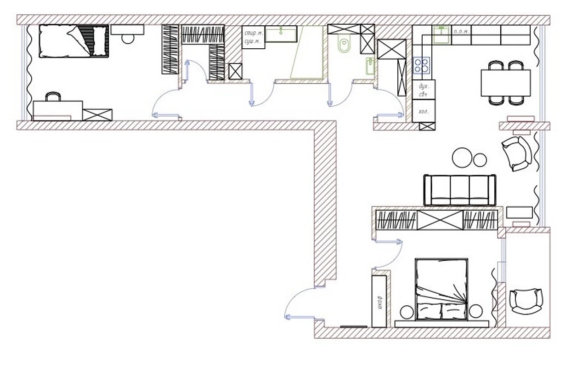

# Умная квартира — 3D-визуализация автоматизации

Интерактивная модель квартиры (вид сверху под углом, «кукольный домик»)
для наглядной демонстрации сценариев и правил умного дома.



## Запуск

Сборка не нужна — достаточно любого статического сервера:

```bash
cd smart-home
python3 -m http.server 8080
# открыть http://localhost:8080
```

Three.js подгружается с `cdn.jsdelivr.net` (версия 0.160.0) через import map.

## Что есть

- **Модель квартиры** по плану: детская, гардероб, ванная, санузел, коридор,
  кухня-столовая, гостиная, прихожая, спальня, лоджия; мебель, окна, двери.
- **Виды**: изометрия, сверху, сбоку; «срез стен» (стены на 1,1 м) и полная высота.
  Клик по комнате приближает камеру к ней.
- **Время суток**: солнце, тени и небо меняются; есть ускоренное время (▶).
- **Устройства** (маркеры в 3D кликабельны):
  свет с диммированием, моторизованные шторы, кондиционеры, тёплый пол,
  датчики протечки / дыма / движения / открытия двери, умный замок,
  кран перекрытия воды, камера, ТВ, стиральная машина, робот-пылесос.
- **Сценарии**: Утро, Ухожу, Я дома, Кино, Ночь, Вечер.
- **Правила автоматизации** (включаются/выключаются в интерфейсе):
  протечка → перекрыть воду; дым → весь свет, шторы, отключить климат, открыть замок;
  движение → свет (ночью 15%); охрана в режиме «Не дома»; замок → свет в прихожей;
  закат/рассвет → шторы; жарко в спальне → кондиционер; сработал автомат → уведомление.
- **Электрощиток** (кнопка «Щиток» на панели или маркер на стене прихожей): три ряда автоматов
  по фотографии щитка — номиналы, типы (ввод, дифавтомат 30 мА, автомат) и все подписи с наклеек.
  Выбор автомата подсвечивает его зоны на плане и ставит метки потребителей; рычаг отключает линию,
  и устройства этой линии теряют питание. Для дифавтоматов есть «Тест УЗО» (имитация срабатывания).
- **Паспорт квартиры** (кнопка «Паспорт» или «Паспорт комнаты»): всё, что есть в квартире, —
  отделка, окна и стеклопакеты, двери и доводчики, радиаторы и терморегуляторы, сантехника,
  техника, светильники и лампы, щиток и автоматы, роутер и модем, датчики, шторы, мебель, декор.
  У каждой записи: помещение, категория, где именно, бренд, модель, артикул, характеристики,
  количество, где купить, ссылка, цена, даты покупки и гарантии, заметки. Поиск, фильтры,
  «только незаполненные»; выбранная запись подсвечивается на плане. Начальный список (≈260 позиций)
  собран из плана и фото; пустые поля заполняются в интерфейсе.
  В опубликованной версии записи хранятся в базе страницы и видны на любом устройстве;
  в локальной — в браузере, с выгрузкой и загрузкой JSON.
- **Документы** (вкладка паспорта): чертежи, инструкции, чеки, гарантии, договоры и фото,
  каждый с типом, помещением, датой и привязкой к позициям паспорта; у позиции видны её документы,
  к ней можно прикрепить файл. В опубликованной версии файлы хранятся в хранилище страницы,
  в репозитории — в папке [`docs/`](docs/) со списком `docs/manifest.json`.
- **Имитация событий** и журнал.

## Структура

| Файл | Назначение |
|---|---|
| `src/plan.js` | Геометрия: стены, окна, двери, комнаты, мебель, расстановка устройств (в пикселях плана, 70 px ≈ 1 м) |
| `src/palette.js` | Цветовая гамма интерьера — **все цвета модели в одном месте** |
| `src/scene.js` | Рендер, камера, стены, полы, мебель, время суток |
| `src/devices.js` | 3D-модели устройств, их анимация и маркеры |
| `src/home.js` | Состояние, сценарии, правила, имитация климата |
| `src/ui.js` | Панели управления |
| `src/panel.js` | Электрощиток: автоматы, подписи, зоны и потребители каждой линии |
| `src/panelui.js` | Схема щитка, включение/отключение автоматов, подсветка зон |
| `src/inventory-seed.js` | Паспорт квартиры: категории, поля карточки и начальный список |
| `src/inventory.js` | Хранение паспорта: база страницы или браузер + JSON |
| `src/inventoryui.js` | Интерфейс паспорта и документов: список, фильтры, карточки, место на плане |
| `docs/` | Документы квартиры: план, развёртка ванной, фото щитка и интерьера (`manifest.json` — список и привязки) |
| `src/bridge.js`, `src/config.js` | Необязательное подключение к Home Assistant |

## Подключение к Home Assistant

Заполните `url`, `token` и соответствие `entities` в `src/config.js`.
Состояния из HA будут отражаться в сцене, а действия в интерфейсе — вызывать
сервисы HA (`light.turn_on`, `cover.set_cover_position`, `lock.lock`, …).

Из консоли браузера тоже можно управлять: `smartHome.set('light.living', { on: true, brightness: 40 })`.

## Цвета и размеры

Размеры сняты с плана: масштаб подобран по двуспальной кровати 1,6 м и дверям 0,8 м.

Интерьер воспроизведён по фотографиям проекта, все цвета собраны в `src/palette.js`:
- пол — ламинат «ёлочкой» BerryAlloc Chateau Walnut Brown (процедурная текстура); в ванной и санузле бежевый керамогранит;
- стены светлые тёплые; в детской пыльно-розовые, в спальне оливковая стена за мягким изголовьем;
- гостиная: светлый диван на золотых ножках, круглое кресло из серого велюра, золотые столики на чёрных основаниях,
  чёрно-белый геометрический ковёр, витрины с подсветкой, стена с обоями, хрустальная люстра с золотым кольцом;
- кухня: светлые низы, верх цвета тауп с двумя витринами, чёрные фартук и столешница;
  мраморный стол на золотом основании, оливковые велюровые стулья, подвес из стеклянных шаров;
- шторы золотисто-горчичные, в спальне оливково-коричневые;
- детская: розовая кровать, белые шкафы, кресло-качалка; прихожая: белые шкафы и зелёная скамья.

Расстановка мебели повторяет фотографии:
- гостиная — диван спинкой к стене с обоями (перегородка со спальней), консоль у окна,
  круглое кресло у колонны между кухней и гостиной, витрина в стене у входа на кухню,
  зеркальная стена в торце со стороны прихожей и барная тележка рядом; телевизора в гостиной нет;
- спальня — изголовье во всю стену у оливковой стены, подвесы-шары у белых тумб,
  комод с ТВ и шкаф вдоль перегородки, кондиционер над дверью;
- детская — шкафы на стене с дверью, кондиционер над дверью, кровать вдоль северной стены,
  круглое зеркало над тумбой, лампа с перьями и кресло-качалка;
- прихожая — шкафы с золотыми ручками, в торце скамья и картина с тропической птицей;
- ванная — колонна стиральная+сушильная машины, рифлёная тумба, круглое зеркало с подсветкой, ванна со шторкой.
